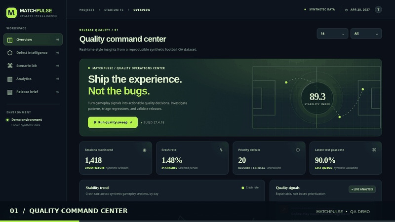
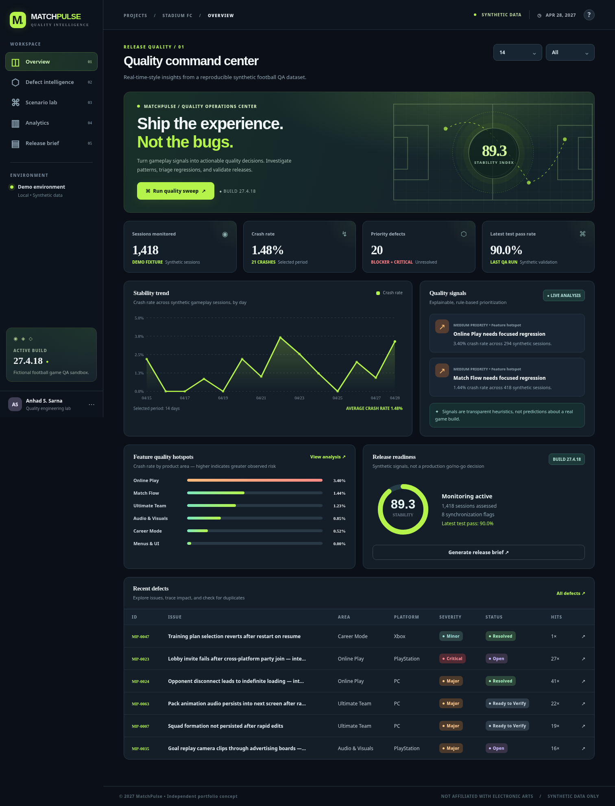
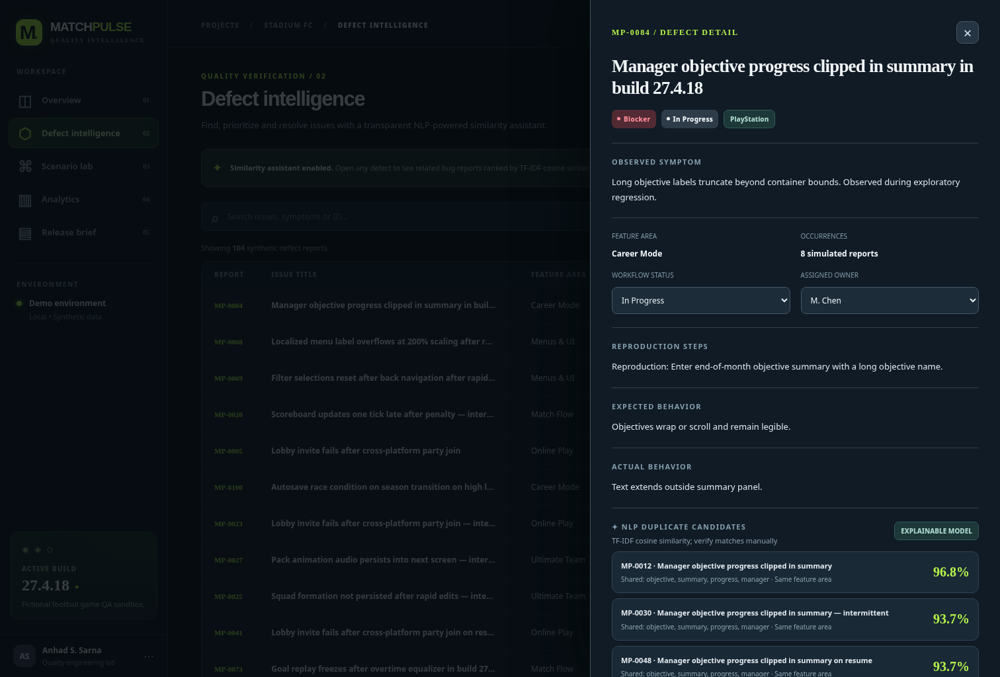
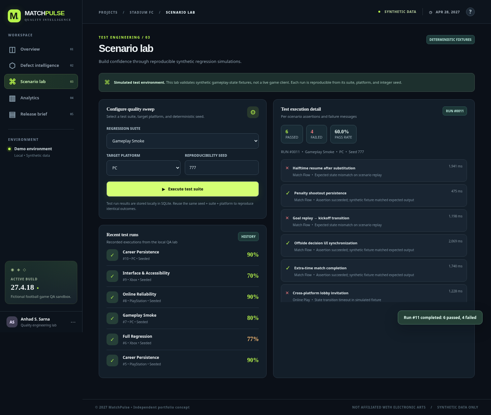

<div align="center">
  

  # MATCHPULSE
  ### Game Quality Intelligence Platform
  **A QA analytics, defect triage and test orchestration sandbox for a fictional football game.**

  `Python 3.11+` · `SQLite` · `Vanilla JS` · `HTML/CSS` · `NLP (TF-IDF)` · `Unittest` · `GitHub Actions`

  > Independent portfolio case study designed around the responsibilities of a game Quality Designer. **Not affiliated with Electronic Arts, EA SPORTS FC, or any game publisher. All gameplay data, incidents and test runs are synthetic.**
</div>

[](docs/demo.mp4)

**[▶ Watch the 12-second interface walkthrough (MP4)](docs/demo.mp4)** · [Open the animated preview](docs/demo.gif)

*The walkthrough uses browser-rendered application screens and seeded synthetic API fixtures; it does not depict a real game client or production telemetry.*



## Why this project exists

Quality teams need to know *what is broken, where it is happening, and what to prioritize.* MatchPulse demonstrates that workflow using a realistic but **completely fictional** football-game data model. It turns QA sessions into structured stability metrics, gives analysts an explainable duplicate-report assistant, simulates regression tests and creates readable stakeholder release briefs.

## ✨ Working features

| Workspace | What you can do |
| --- | --- |
| **Quality command center** | Explore 7/14/30-day stability trends, monitored sessions, crashes, network desyncs and open severe defects. Filter by PC, PlayStation and Xbox. |
| **Defect intelligence** | Search/filter 104 synthetic bug reports, inspect expected/actual behavior and reproduction steps, update owner/status, and export the backlog as CSV. |
| **AI-assisted similarity** | Rank candidate duplicate reports with an explainable **TF-IDF cosine similarity model** and shared keywords. No paid API or LLM needed. |
| **Scenario lab** | Run deterministic synthetic QA fixtures across five suites and three platforms, view individual assertions, and save runs to SQLite. |
| **Analytics** | Compare cross-platform crash rates, FPS and feature-specific hotspots. Highlight rule-based anomaly signals with evidence. |
| **Release brief** | Generate a stakeholder-oriented Markdown summary of risks, quality metrics and recommended QA follow-ups. |

### Defect investigation with explainable NLP



### Reproducible scenario test lab



## 🚀 Quick start — one command

**Requirements:** Python 3.11+ and a web browser. There are **no third-party runtime dependencies**. No JavaScript build, pip installation, Docker or external accounts required.

```bash
# macOS / Linux
python3 main.py
# or ./run.sh

# Windows
py -3 main.py
# or double-click run.bat
```

Then open **http://127.0.0.1:8765** in your browser.

The first launch generates a deterministic local SQLite dataset. Changes to issue statuses, owners and QA test runs persist until reset.

To reset the demo to its reproducible initial state:

```bash
python3 main.py --reset
```

Optional: Choose a different port using `python3 main.py --port 9000`.

## ✅ Test the project

```bash
python3 -m unittest discover -s tests -p "test_*.py" -v
```

**43 automated checks** cover dataset seeding, deterministic reproducibility, platform filtering, metrics, issue search and triage, candidate similarity ranking, QA-run simulation, report generation, and API routes. A cross-platform GitHub Actions workflow is configured for Windows, Ubuntu and macOS. Its cloud execution should be checked after you push the repository.

## Technical architecture

```text
                          Browser Dashboard
                    HTML + CSS + vanilla JS
                                |
                       HTTP / JSON API
                                |
                  Python ThreadingHTTPServer
                                |
    +---------------------------+-------------------------+
    |                           |                         |
Telemetry Analytics     Defect Intelligence       Scenario Test Lab
 crash rate, FPS,        searchable issue log      seeded test suites,
 desync, anomalies       TF-IDF similarity          reproducible results
    |                           |                         |
    +---------------------------+-------------------------+
                                |
                        Local SQLite Store
                Sessions | Issues | QA Runs | Audit
                                |
                      Markdown + CSV Export
```

### Selected endpoints

| Method | Route | Purpose |
| --- | --- | --- |
| `GET` | `/api/overview?days=14&platform=All` | Session and stability metrics |
| `GET` | `/api/issues?severity=Critical` | Filtered defect backlog |
| `GET` | `/api/issues/1` | Reproduction steps, status and duplicate suggestions |
| `PATCH` | `/api/issues/1` | Set issue owner, severity or status |
| `POST` | `/api/runs` | Run a deterministic simulation (suite, platform, seed) |
| `GET` | `/api/runs/11` | Test-run details |
| `GET` | `/api/report.md` | Markdown release briefing |
| `GET` | `/api/issues.csv` | Defect CSV export |
| `POST` | `/api/reset` | Restore synthetic fixture data |

Example scenario request:

```bash
curl -s -X POST http://127.0.0.1:8765/api/runs \
  -H 'Content-Type: application/json' \
  -d '{"suite":"Gameplay Smoke","platform":"PC","seed":777}'
```

### Dataset and assumptions

- The fixed **April 28, 2027** demo reference date ensures charts do not drift between portfolio reviews.
- The app seeds approximately **3,000 fictional gameplay sessions**, **104 fictional issues**, and **10 historic synthetic regression runs**. There is a deliberate online-play crash hotspot to make investigation meaningful.
- The stability index is a **demonstrative weighted rule**, not a validated game-quality industry standard.
- The anomaly rule compares the last three days against a seven-day baseline; it is **not a trained predictive model**.
- Candidate duplicate detection uses stopword removal, term counts, inverse-document frequency and cosine similarity. A high score **does not prove two issues share a root cause**.
- QA scenario outcomes are generated from a seeded simulation, **not from testing a running game client**. Reported tests in CI cover *this project itself*.

## How to demo to a recruiter (90 seconds)

1. **Overview** → compare crash trends and feature hotspots across platforms.
2. **Defect intelligence** → open a high-severity Online Play issue, read its reproduction steps and see similar reports.
3. **Scenario lab** → launch `Gameplay Smoke` on `PC` with seed `777`, inspect assertion outcomes, then repeat to show determinism.
4. **Release brief** → export the Markdown summary and discuss how data-driven QA supports product teams.

## Project structure

```text
MatchPulse-Game-QA/
├── main.py                    # Local web server, HTTP routes and API
├── engine.py                  # SQLite, datasets, metrics, simulation and TF-IDF
├── web/
│   ├── index.html             # Dashboard application shell
│   ├── style.css              # Responsive dark-mode interface
│   ├── app.js                 # Charts, navigation, data queries and interactions
│   └── favicon.svg
├── tests/
│   ├── test_engine.py         # 43 standard-library automated checks
│   └── visual_smoke.py        # Optional Playwright browser visual inspection
├── docs/                      # Verified interface screenshots
├── samples/                   # Exported example QA report and data
├── .github/workflows/ci.yml   # Cross-platform unit-test matrix
├── run.sh / run.bat           # Convenient launch scripts
└── README.md
```

## Limitations / potential next steps

This is a portfolio simulator. It does not access EA games, internal services or private telemetry and should **not be represented as production game QA experience**. The demo server intentionally binds to `127.0.0.1` and has no authentication—do not expose it publicly as-is. Future improvements could include integrations with authorized issue trackers, real test-harness adapters, performance profiling, user accounts, and an evaluation set for duplicate detection precision/recall.

---

**Created by Anhad Singh Sarna** · [GitHub](https://github.com/anhads3ngh) · Independent game quality engineering project.
