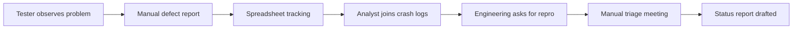
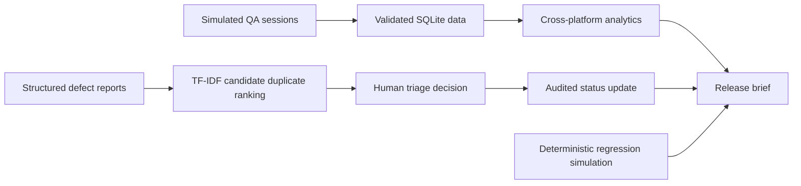

# MatchPulse — Discovery, QA process mapping, and future-state design

## Context

This document is a **simulated product-discovery exercise** created for an independent game-quality portfolio project. No EA employees, actual game teams or external participants were interviewed.

### The fictional quality team

A quality analyst reviews scattered crash logs, spreadsheets and manually written bug reports for a football game across PC, PlayStation and Xbox. Engineering wants reproductions and severity; product wants impact; program management wants an informed readiness summary.

### Hypothetical partner needs

| Partner | Core question | MatchPulse support |
| --- | --- | --- |
| Quality Designer | What changed, and is it reproducible? | Severity filters, full repro detail and deterministic test runs |
| Quality Engineer | Which tests are failing? | Suite-level and test-level histories |
| Data Analyst | Which feature/platform is the outlier? | Filtered crash rate, FPS, desync and hotspot summaries |
| Game Developer | Which symptoms might have one root cause? | Candidate duplicate ranking with shared terms |
| Producer / Program Manager | Is there an actionable release risk? | Automatically generated Markdown release brief |

## Current-state workflow (hypothetical)

Common friction in this **fictional** workflow: duplicated reports, disconnected platform metrics, inconsistent reproduction details, repeated manual status compilation.

## Proposed future-state workflow

### Core design choices

- **Data transparency:** Metrics are defined in terms of measured synthetic records, and anomalies include their threshold evidence.
- **Human review:** Duplicate suggestions are *not automatically merged* and cannot be interpreted as root-cause certainty.
- **Reproducibility:** Each simulated QA run stores suite, platform and seed.
- **Minimal operations cost:** Python standard library + SQLite; zero third-party runtime services.
- **Portfolio safety:** No real game telemetry, privileged services or private information.

## Requirements and acceptance criteria

| Requirement | Acceptance criterion | Evidence |
| --- | --- | --- |
| Filter telemetry by platform and date | Selecting 7/14/30 days or platform changes session metrics | `/api/overview`, analytics tests |
| Explore high-priority defects | Severity/status/feature/search filters yield matching records | `/api/issues`, unit tests, browser walkthrough |
| Reduce triage repetition | Similarity results rank candidate duplicate issues and expose shared keywords | `/api/issues/{id}`, TF-IDF tests |
| Reproduce a test-run result | Identical suite/platform/seed returns identical assertion outcomes | `/api/runs`, deterministic simulation test |
| Generate a stakeholder summary | Export Markdown includes key risk metrics and open blockers | `/api/report.md`, report test |
| Preserve local changes | Updated status/owner stored in SQLite audit table | PATCH endpoint, persistence test |

## Prioritized backlog

**P0 (implemented):** Session metrics, critical issue monitoring, search/filter, deterministic regression runs.  
**P1 (implemented):** TF-IDF similarity suggestions, release reporting, audit trail.  
**P2 (future):** Accessibility audit, ticket tracker integration, signed-in users, CSV session import, QA model evaluation.

## Known limits

This is an illustrative implementation, **not** evidence of stakeholder interviews, live quality discovery, or production game testing. The anomaly detection rule is heuristic, and the NLP ranking has not been benchmarked on a labeled real-world duplicate dataset. The server should remain local because it does not implement authentication.
